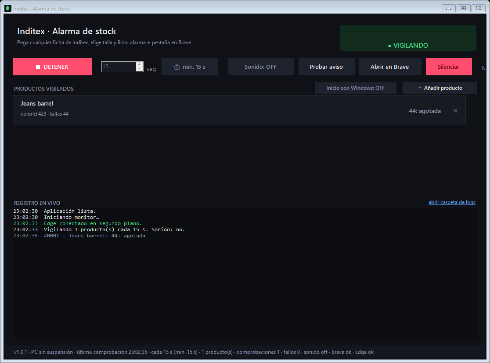
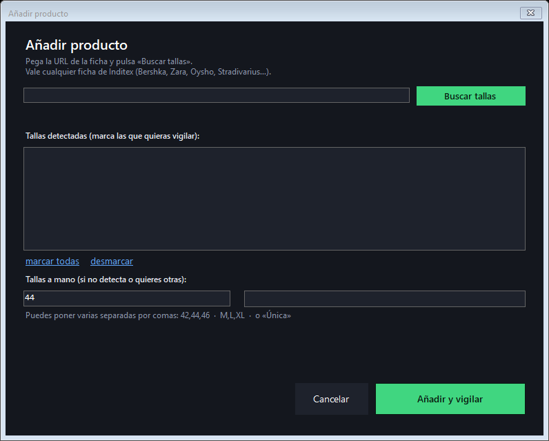
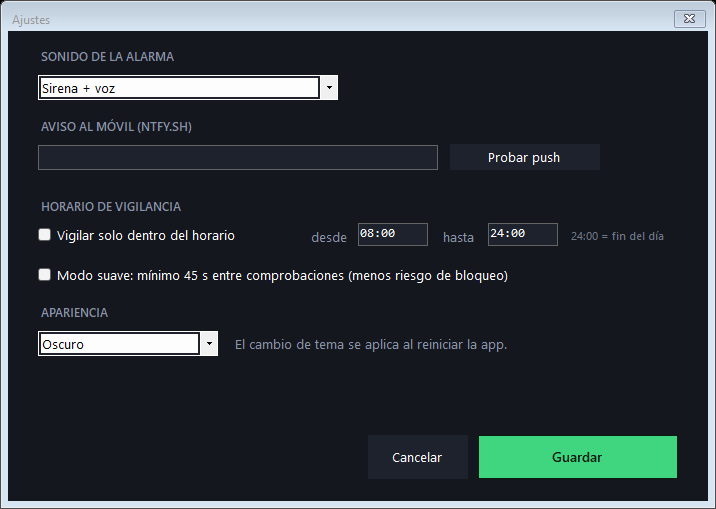

# Inditex Stock Alarm

[](https://github.com/Rediaj04/Inditex-Stock-Alarm/actions/workflows/build.yml)
[](https://github.com/Rediaj04/Inditex-Stock-Alarm/releases/latest)


Windows desktop app that watches the sizes you choose on **Inditex product pages** (Bershka, Zara, Pull&Bear, Stradivarius, Oysho, Massimo Dutti) and alerts you with a siren, a big popup and a tab opened in Brave.

> Personal project, not affiliated with Inditex. Use it responsibly and respect each site's terms.

> **It is only an alarm.** It does not add to cart, fill forms or buy anything. You do the purchase.

> **Free to use and share — not to sell.** Personal use and free sharing are welcome, and you may modify it. Commercial use, resale or presenting it as your own product are not allowed. Keep the copyright notice and credit the original project.



## Supported sites

| Site | Status |
| --- | --- |
| Bershka | ✅ tested (size 44) |
| Zara | ✅ tested (size M) |
| Pull&Bear | ✅ tested via API (its page blocks headless, the API responds) |
| Stradivarius | ✅ tested (size M) |
| Oysho | ✅ tested (size M) |
| Massimo Dutti | ✅ tested via API (sizes 35–42) |
| Uterqüe | ➡️ redirects to Massimo Dutti |
| Zara Home | ➖ not applicable (home goods, no sizes) |

If a site cannot be read, the row shows **ERROR** and the log says why (`sin-tallas`, `api-http`…).

## Download and run (no install needed)

1. Open **Releases** and download `InditexStockAlarm.exe` (portable build).
2. Put it anywhere (Desktop, Documents, USB stick). No installer, no admin rights.
3. Double click. The first time it asks you to add a product.
4. Paste the product URL, hit **Buscar tallas**, pick sizes and press **INICIAR**.

Requirements: **Windows 10/11 64-bit** and a Chromium browser: **Edge** (bundled with Windows), **Chrome** or **Brave**. The hidden monitor uses the first one it finds; the alert tab opens in Brave, or in your default browser if Brave is missing.

> The executable is not signed, so SmartScreen may warn once: *More info → Run anyway*.

## Where data is stored

Portable: `config.json`, `logs/` and the internal browser profile are stored **next to the exe** if the folder is writable. Otherwise it uses `%LOCALAPPDATA%\InditexStockAlarm`.

## Features

- Add any Inditex product by URL; the app reads the **real sizes** (M, L, 44, Única…) and lets you pick which ones to watch.
- Several colours of the same product are grouped in **one row**; alerts tell you which colour has stock.
- **API mode**: after the first load it polls the site's JSON (faster, fewer requests, works even when the page blocks headless).
- **Price, colour and thumbnail** in each row (image from the page).
- 15 s minimum interval with a **lock**: unlocking it below 15 s shows a red warning about the risks.
- **Backoff** on failures (30→60→120→180 s) and a **watchdog** that restarts Edge if it dies.
- **Alert window** with a large product image, price, big OK, **Open product** and **Already bought · pause** buttons; the siren keeps playing until you act.
- **Snooze 30 min** (the same button cancels it), **pause per product**, and “already bought → pause this product”.
- **Settings**: sound mode (siren+voice / siren / voice / beep / **your own WAV-MP3-WMA**), ntfy push with a test button, schedule, gentle mode, **start with Windows**, **start minimised**, **alert screen (detects your monitors and moves Brave there on alerts)**, **UI scale (100/125/150 %)**, **language (Spanish/English)** and dark/light theme.
- Tray tooltip with the current status. Prevents Windows from sleeping while watching.
- Optional **update notice** (not forced) when a newer GitHub Release exists.
- Live log with a **clear** button (does not delete files) and daily log files; `logs\historial.csv` with every stock change.


## Usage

1. Press **＋ Añadir producto**, paste one URL per line (several = several colours).
2. Press **Buscar tallas**: the app opens the page in a hidden Edge and lists the real sizes with their state.
3. Tick the sizes you want (available ones are pre-ticked). If the site cannot be read, type them by hand (`44`, `M,L`, `Única`).
4. Press **INICIAR** (it also starts on launch). Minimise to the tray if you want.
5. Per product, the **⋯** menu lets you check now, edit sizes/name, pause or delete.

Small windows are supported: buttons wrap and rows are never clipped.





> Sizes cannot be preselected by URL: the tab opens on the right product and colour, and you tap the size and “Add to cart”.

## Configuration

`config.json`:

```json
{
  "intervalSeconds": 15,
  "allowFastInterval": false,
  "soundEnabled": true,
  "soundMode": "both",
  "openInBrave": true,
  "ntfyTopic": "",
  "gentleMode": false,
  "scheduleEnabled": false,
  "scheduleStart": "08:00",
  "scheduleEnd": "24:00",
  "theme": "dark",
  "uiScale": 100,
  "customSoundPath": "",
  "startMinimized": false,
  "alertScreen": -1,
  "items": [
    {
      "name": "Jeans barrel",
      "url": "https://www.bershka.com/es/jeans-barrel-c0p229733871.html?colorId=428",
      "sizes": "44"
    }
  ]
}
```

- `intervalSeconds`: 15–120 (or 5–120 if you unlock the lock).
- `soundMode`: `both`, `siren`, `voice`, `beep`.
- `theme`: `dark` or `light` (applies on restart).
- `alertScreen`: `-1` = default screen, `0` = first monitor, `1` = second monitor…
- `ntfyTopic`: if set, sends a push to ntfy.sh on stock.

## How detection works

1. **API (preferred)**: discovers `storeId` and `productId` from the page (`pelement`, `c0p…` or the HTML), resolves bundles and reads the internal `itxrest` JSON. That is where sizes, state, colour and price come from. Later checks go straight to that JSON, without reloading the page.
2. **DOM (fallback)**: reloads the page and reads the size buttons (`button.size-button`, `button.size-item`, Zara's modal after “Añadir”, etc.), accepting cookie/location banners and ignoring recommendation carousels.
3. If nothing works, the row shows **ERROR** with the reason.

## Tests

```bat
dotnet test tests/InditexStockAlarm.Tests/InditexStockAlarm.Tests.csproj -c Release
```

Covers URL parsing (Bershka, Zara, Pull&Bear), sizes (`44`, `M,L`), name guessing and config save/load. CI runs them on every push. A scheduled workflow (`probe.yml`) checks real product pages weekly to detect site changes.

## Troubleshooting

- **Row shows ERROR / `api-…`**: make sure Edge, Chrome or Brave is installed, wait a few seconds and press “Comprobar ahora” again. If it persists, the site may be blocking requests; the log shows the exact reason.
- **No sound**: check that `Sonido` is ON, the Windows volume and the output device. Use `Probar` to test it.
- **Alert on the wrong monitor**: Settings → `Pantalla de la alerta`.
- **The folder grows a lot**: it is the hidden browser cache (`edge-profile`). Close the app and delete that folder to reset it; it is recreated on the next run.
- **First check is slow**: the browser profile is being created; later checks go straight to the API and are much faster.

## Updating

Download the new `InditexStockAlarm.exe` from Releases and replace the old one; `config.json` and `logs/` are kept. To move the app to another PC, copy the exe and `config.json`.

## Privacy

- No account, no telemetry, no analytics.
- `config.json`, `logs/` and the browser profile stay on your PC.
- Only if you set an `ntfyTopic`, the app sends the product name, size state and URL to ntfy.sh.

## Build

```bat
build-release.cmd
```

Generates `release\InditexStockAlarm.exe` (single self-contained file). Quick framework-dependent build:

```bat
dotnet publish -c Release -r win-x64 --self-contained false -p:PublishSingleFile=true -o publish
```

## Known limitations

- Inditex only; selectors may need updates if they redesign the pages.
- With 15 s, a very short restock can be missed.
- If the app or PC is off/suspended, it stops watching.
- No purchase automation.

## Attribution

If you copy or redistribute this project (or a modified version), keep the `LICENSE` file with the copyright notice, credit the original project and do not present it as your own or sell it. A link back to the original repository is required where reasonably possible.

## License

Source-available, non-commercial. See [LICENSE](LICENSE). Personal use and free sharing are allowed; commercial use, resale and claiming it as your own are not.

---

# Versión en español

Aplicación de escritorio para Windows que vigila las tallas que elijas en **fichas de webs de Inditex** (Bershka, Zara, Pull&Bear, Stradivarius, Oysho, Massimo Dutti) y te avisa con sirena, ventana emergente y una pestaña abierta en Brave.

> Proyecto personal, sin relación con Inditex. Úsalo de forma responsable y respetando los términos de cada web.

> **Solo es una alarma.** No añade a la cesta, no rellena datos y no compra nada. La compra la haces tú.

> **Gratis para uso personal y para compartir, pero no para vender.** Puedes usarlo, modificarlo y compartirlo gratis. No se permite el uso comercial, la reventa ni presentarlo como producto propio. Mantén el aviso de copyright y da crédito al proyecto original.


## Webs soportadas

| Web | Estado |
| --- | --- |
| Bershka | ✅ probado (talla 44) |
| Zara | ✅ probado (talla M) |
| Pull&Bear | ✅ probado por API (su web bloquea el headless, la API responde) |
| Stradivarius | ✅ probado (talla M) |
| Oysho | ✅ probado (talla M) |
| Massimo Dutti | ✅ probado por API (tallas 35–42) |
| Uterqüe | ➡️ redirige a Massimo Dutti |
| Zara Home | ➖ no aplica: hogar, sin tallas |

Si una web no se puede leer, la fila muestra **ERROR** y el log indica el motivo (`sin-tallas`, `api-http`…).

## Descargar y ejecutar (sin instalar nada)

1. Entra en **Releases** y descarga `InditexStockAlarm.exe` (build portable).
2. Ponlo donde quieras (Escritorio, Documentos, USB). Sin instalador ni administrador.
3. Doble clic. La primera vez te pide añadir un producto.
4. Pega la URL, pulsa **Buscar tallas**, elige tallas y dale a **INICIAR**.

Requisitos: **Windows 10/11 de 64 bits** y un navegador Chromium: **Edge** (incluido en Windows), **Chrome** o **Brave**. El monitor oculto usa el primero que encuentre; la pestaña del aviso se abre en Brave, o en tu navegador por defecto si no está.

> El ejecutable no está firmado, así que SmartScreen puede avisar una vez: *Más información → Ejecutar de todas formas*.

## Dónde guarda los datos

Portable: `config.json`, `logs/` y el perfil interno del navegador se guardan **junto al .exe** si la carpeta permite escribir. Si no, usa `%LOCALAPPDATA%\InditexStockAlarm`.

## Qué hace

- Añades cualquier producto de Inditex por URL; la app lee las **tallas reales** (M, L, 44, Única…) y te deja elegir cuáles vigilar.
- Varios colores del mismo producto se agrupan en **una sola fila**; el aviso te dice qué color tiene stock.
- **Modo API**: tras la primera carga consulta el JSON de la web (más rápido, menos peticiones y funciona aunque la página bloquee el headless).
- **Precio, color y miniatura** en cada fila (imagen de la ficha).
- Intervalo mínimo de 15 s con **candado**: si lo desbloqueas por debajo de 15 s sale un aviso rojo con los riesgos.
- **Backoff** ante fallos (30→60→120→180 s) y **watchdog** que reinicia Edge si se cae.
- **Ventana de aviso** con imagen grande, precio, botón OK, **Abrir ficha** y **Ya he comprado · pausar**; la sirena no para hasta que actúes.
- **Snooze 30 min** (el mismo botón lo cancela), **pausar por producto** y “ya he comprado → pausar este producto”.
- **Ajustes**: modo de sonido (sirena+voz / sirena / voz / pitido / **tu propio WAV-MP3-WMA**), ntfy con botón de prueba, horario, modo suave, **inicio con Windows**, **arrancar minimizada**, **pantalla de la alerta (detecta tus pantallas y mueve Brave allí)**, **escala de interfaz (100/125/150 %)**, **idioma (español/inglés)** y tema oscuro/claro.
- Tooltip en la bandeja con el estado actual. Impide que Windows entre en suspensión mientras vigila.
- **Aviso de actualización** opcional (no obligatorio) si hay un Release nuevo.
- Registro en vivo con botón **limpiar** (no borra archivos), logs diarios y `logs\historial.csv` con cada cambio de stock.


## Uso

1. Pulsa **＋ Añadir producto** y pega una URL por línea (varias = varios colores).
2. Pulsa **Buscar tallas**: la app abre la ficha en un Edge oculto y lista las tallas reales con su estado.
3. Marca las que quieras (las disponibles vienen marcadas). Si la web no se deja leer, escríbelas a mano (`44`, `M,L`, `Única`).
4. Pulsa **INICIAR** (también arranca al abrir). Minimiza a la bandeja si quieres.
5. En cada producto, el menú **⋯** te deja comprobar ahora, editar tallas/nombre, pausar o eliminar.

La ventana se adapta a tamaños pequeños: los botones se envuelven y las filas no se recortan.


> La talla no se puede preseleccionar por URL: la pestaña se abre en la ficha y color correctos, y tú tocas la talla y “Añadir a la cesta”.

## Configuración

`config.json`:

```json
{
  "intervalSeconds": 15,
  "allowFastInterval": false,
  "soundEnabled": true,
  "soundMode": "both",
  "openInBrave": true,
  "ntfyTopic": "",
  "gentleMode": false,
  "scheduleEnabled": false,
  "scheduleStart": "08:00",
  "scheduleEnd": "24:00",
  "theme": "dark",
  "uiScale": 100,
  "customSoundPath": "",
  "startMinimized": false,
  "alertScreen": -1,
  "items": [
    {
      "name": "Jeans barrel",
      "url": "https://www.bershka.com/es/jeans-barrel-c0p229733871.html?colorId=428",
      "sizes": "44"
    }
  ]
}
```

- `intervalSeconds`: 15–120 (o 5–120 si desbloqueas el candado).
- `soundMode`: `both`, `siren`, `voice`, `beep`.
- `theme`: `dark` o `light` (se aplica al reiniciar).
- `alertScreen`: `-1` = pantalla predeterminada, `0` = primera pantalla, `1` = segunda…
- `ntfyTopic`: si lo rellenas, envía un push a ntfy.sh al detectar stock.

## Cómo detecta el stock

1. **API (preferido)**: descubre `storeId` y `productId` de la ficha (`pelement`, `c0p…` o el HTML), resuelve bundles y lee el JSON interno `itxrest`. De ahí salen tallas, estado, color y precio. Las siguientes comprobaciones van directas a ese JSON, sin recargar la página.
2. **DOM (respaldo)**: recarga la ficha y lee los botones de talla (`button.size-button`, `button.size-item`, el modal de Zara tras “Añadir”…), acepta banners de cookies/ubicación e ignora los carruseles de recomendados.
3. Si nada funciona, la fila muestra **ERROR** con el motivo.

## Pruebas

```bat
dotnet test tests/InditexStockAlarm.Tests/InditexStockAlarm.Tests.csproj -c Release
```

Cubren el parseo de URLs (Bershka, Zara, Pull&Bear), tallas (`44`, `M,L`), nombres deducidos y guardado/carga de `config.json`. El CI las ejecuta en cada push. Un workflow programado (`probe.yml`) comprueba fichas reales cada semana para detectar cambios de las webs.

## Problemas frecuentes

- **La fila muestra ERROR / `api-…`**: comprueba que Edge, Chrome o Brave está instalado, espera unos segundos y pulsa “Comprobar ahora”. Si sigue, la web puede estar bloqueando peticiones; el log dice el motivo exacto.
- **No suena**: revisa que `Sonido` esté ON, el volumen de Windows y el dispositivo de salida. Usa `Probar` para comprobarlo.
- **La alerta sale en otro monitor**: Ajustes → `Pantalla de la alerta`.
- **La carpeta crece mucho**: es la caché del navegador oculto (`edge-profile`). Cierra la app y borra esa carpeta para reiniciarla; se recrea sola.
- **La primera comprobación tarda**: se está creando el perfil del navegador; las siguientes van directas a la API y son mucho más rápidas.

## Actualizar

Descarga el nuevo `InditexStockAlarm.exe` desde Releases y reemplaza el anterior; `config.json` y `logs/` se conservan. Para llevar la app a otro PC, copia el exe y `config.json`.

## Privacidad

- Sin cuenta, sin telemetría y sin analíticas.
- `config.json`, `logs/` y el perfil del navegador se quedan en tu PC.
- Solo si rellenas `ntfyTopic`, la app envía el nombre del producto, el estado de la talla y la URL a ntfy.sh.

## Compilar

```bat
build-release.cmd
```

Genera `release\InditexStockAlarm.exe` (autocontenido). Build rápida que usa el runtime instalado:

```bat
dotnet publish -c Release -r win-x64 --self-contained false -p:PublishSingleFile=true -o publish
```

## Límites conocidos

- Solo Inditex; los selectores pueden necesitar ajustes si rediseñan las fichas.
- Con 15 s, un reestock muy corto puede escaparse.
- Si la app o el PC se apagan/suspenden, deja de vigilar.
- No automatiza la compra.

## Atribución

Si copias o redistribuyes este proyecto (o una versión modificada), mantén el archivo `LICENSE` con el aviso de copyright, da crédito al proyecto original y no lo presentes como propio ni lo vendas. Un enlace al repositorio original es obligatorio cuando sea razonablemente posible.

## Licencia

Source-available, no comercial. Ver [LICENSE](LICENSE). Se permite el uso personal y compartirlo gratis; no se permite el uso comercial, la reventa ni presentarlo como propio.
