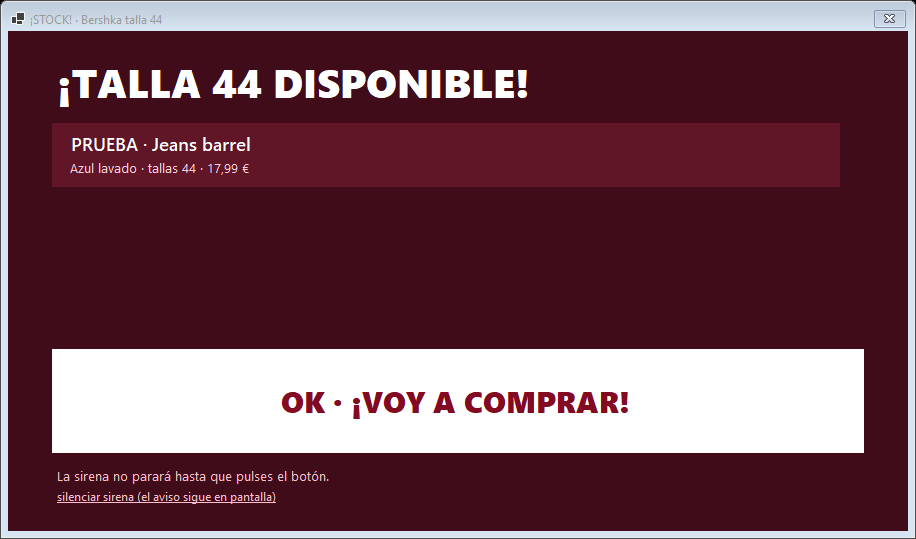

# Inditex Stock Alarm

[](https://github.com/Rediaj04/Inditex-Stock-Alarm/actions/workflows/build.yml)
[](https://github.com/Rediaj04/Inditex-Stock-Alarm/releases/latest)
[](LICENSE)


Aplicación de escritorio para Windows que vigila la disponibilidad de las tallas que elijas en fichas de **webs de Inditex** (Bershka, Zara, Pull&Bear, Stradivarius, Oysho, Massimo Dutti…) y te avisa con alarma, ventana emergente y una pestaña abierta en Brave.

> Proyecto personal, sin relación con Inditex. Úsalo de forma responsable y respetando los términos de cada web.

> **Solo es una alarma.** No añade a la cesta, no rellena datos y no compra nada. Cuando detecta stock, avisa y abre la ficha; la compra la haces tú.

## 100 % abierto: cópialo, cámbialo, mejóralo

El código es libre (MIT): puedes copiarlo, modificarlo, forkerlo y redistribuirlo, incluso sin pedir permiso. No me molesta que se reutilice.

Lo único que pido (y que la licencia MIT ya exige) es **mantener el aviso de copyright** y, si te apetece, enlazar el repo original y darme las gracias. Con eso me vale.


## Webs soportadas

| Web | Estado |
| --- | --- |
| Bershka | ✅ probado |
| Zara | ✅ probado |
| Pull&Bear | ⚠️ misma plataforma, probablemente funciona (sin verificar) |
| Stradivarius | ⚠️ misma plataforma, probablemente funciona (sin verificar) |
| Oysho | ⚠️ misma plataforma, probablemente funciona (sin verificar) |
| Massimo Dutti | ⚠️ misma plataforma, probablemente funciona (sin verificar) |
| Uterqüe / Zara Home | ⚠️ sin verificar |

La app acepta cualquier URL de esos dominios. Si en una web no encuentra las tallas, lo muestra como **ERROR** en la fila del producto (no falla en silencio) y el log dice `sin-tallas`.

## Descargar y ejecutar (sin instalar nada)

1. Ve a **Releases** y descarga `InditexStockAlarm.exe` (build portable, ya lleva todo dentro).
2. Ponlo en una carpeta normal (Escritorio, Documentos, un USB…). No necesita instalador ni administrador.
3. Doble clic. La primera vez te pide añadir un producto.
4. Pega la URL de la ficha, escribe la talla y dale a **INICIAR**.

Requisitos: **Windows 10/11 de 64 bits** y **Microsoft Edge** (viene preinstalado en Windows). Brave es opcional: si no está, el aviso se abre en tu navegador por defecto.

> El ejecutable no está firmado, así que SmartScreen puede avisar la primera vez: *Más información → Ejecutar de todas formas*.

## Dónde guarda los datos

La app es portable: guarda `config.json`, `logs/` y el perfil interno de Edge **junto al .exe** si la carpeta es escribible. Si no lo es (por ejemplo en `Program Files`), usa `%LOCALAPPDATA%\InditexStockAlarm`.

## Qué hace

- Añades productos pegando su URL y escribiendo la talla (o varias: `42,44,46`, o letras: `S,M,L`).
- Consulta el stock cada 15 s (mínimo recomendado) en un **Edge oculto en segundo plano**, así que no te abre ventanas de Edge.
- **Candado de 15 s**: el intervalo no baja de 15 s. Si pulsas el candado `🔒 mín. 15 s`, sale un aviso en rojo explicando las consecuencias; si lo aceptas, se desbloquea hasta 5 s (bajo tu responsabilidad).
- Cuando la talla pasa a disponible:
  - **Ventana emergente grande y siempre encima** con un botón `OK · ¡VOY A COMPRAR!`.
  - **Sirena + voz** que no para hasta que pulsas OK (o silencias). Se puede desactivar con `Sonido: ON/OFF`.
  - Abre la **pestaña en Brave** con el producto y color exactos.
  - Notificación en la bandeja y parpadeo de la ventana.
- Si la talla sigue disponible, repite el aviso cada 2 minutos (con 5 min de silencio tras pulsar OK).
- Impide que el PC entre en suspensión mientras vigila.
- **Iniciar con Windows** opcional desde la propia ventana (checkbox).
- **Aviso al móvil** opcional con [ntfy](https://ntfy.sh) (push gratis, sin cuenta).
- **Historial CSV** con cada cambio de stock (`logs\historial.csv`).
- **Comprobación de actualizaciones** contra GitHub Releases.
- Registro en vivo y en `logs\monitor-AAAAMMDD.log`.



## Uso

1. Pulsa **＋ Añadir producto**, pega la URL de la ficha y escribe la talla.
   - El color se toma del parámetro `colorId` de la URL o de la propia URL (Zara usa `v1`).
   - Puedes poner varias tallas separadas por comas.
2. Pulsa **INICIAR** (arranca solo al abrir).
3. Deja la app abierta o minimizada en la bandeja.

> La talla no se puede preseleccionar por URL: la pestaña se abre en la ficha y color correctos, y tú tocas la talla y “Añadir a la cesta”.

## Configuración

`config.json`:

```json
{
  "intervalSeconds": 15,
  "allowFastInterval": false,
  "soundEnabled": true,
  "openInBrave": true,
  "ntfyTopic": "",
  "items": [
    {
      "name": "Jeans barrel",
      "url": "https://www.bershka.com/es/jeans-barrel-c0p229733871.html?colorId=428",
      "sizes": "44"
    },
    {
      "name": "Camiseta Zara",
      "url": "https://www.zara.com/es/es/camiseta-tank-rib-basica-p04087450.html",
      "sizes": "M"
    }
  ]
}
```

- `intervalSeconds`: 15–120 (o 5–120 si desbloqueas el candado).
- `allowFastInterval`: si es `true`, permite bajar de 15 s sin pasar por el aviso.
- `soundEnabled`: sirena y voz.
- `openInBrave`: abrir pestaña automáticamente al detectar stock.
- `ntfyTopic`: si lo rellenas, envía un push al móvil al detectar stock (ver abajo).
- `items`: lista de productos. También se puede editar a mano y reiniciar.
  - **Varios colores**: añade un ítem por color (la misma ficha con otro `colorId` o `v1`). La app avisa si cualquiera tiene stock.

## Aviso al móvil con ntfy (gratis, sin cuenta)

1. Instala la app **ntfy** en tu móvil (Android/iOS) o abre [ntfy.sh](https://ntfy.sh).
2. Suscríbete a un tema inventado y difícil de adivinar, por ejemplo `stock-7f3k9x2`.
3. En `config.json` pon `"ntfyTopic": "stock-7f3k9x2"`.
4. Reinicia la app. Al detectar stock llegará un push urgente con producto, talla, precio y enlace.

El tema es público: usa un nombre largo y aleatorio. No pongas datos personales.

## Iniciar con Windows

Marca **Iniciar con Windows** en la cabecera de la lista de productos. Crea un acceso directo en la carpeta de inicio del usuario; desmárcalo para quitarlo.

## Historial CSV

Cada cambio de disponibilidad se añade a `logs\historial.csv` (fecha, hora, producto, tallas, estado, color y URL). Se abre con Excel o cualquier hoja de cálculo.

## Cómo detecta el stock

Carga la ficha en un Edge headless y lee las tallas de la página:

- Bershka y similares: botones `button.size-button` (deshabilitado = agotada; `--low-stock` = pocas).
- Zara: el selector aparece al pulsar “Añadir”; la app lo abre solo para leer las tallas (`button.size-selector-sizes-size__button`), nunca confirma la compra.
- Además hay un buscador genérico: botones/elementos clicables cuyo texto coincide con la talla y que están dentro de un contenedor con “size” en su clase o id.

Se recarga la ficha en cada comprobación (con imágenes y fuentes bloqueadas para que sea ligero).

## Compilar

Con el SDK de .NET 10:

```bat
build-release.cmd
```

Genera `release\InditexStockAlarm.exe` (un solo archivo autocontenido). Para una build rápida que use el runtime instalado:

```bat
dotnet publish -c Release -r win-x64 --self-contained false -p:PublishSingleFile=true -o publish
```

El repositorio incluye un workflow de GitHub Actions (`.github/workflows/build.yml`) que compila la versión portable en cada push y crea un Release al subir un tag `v*`.

## Límites conocidos

- Solo webs de Inditex; el parseo de URL y los selectores son suyos. Si cambian el diseño de la ficha, habrá que ajustar los selectores.
- Con 15 s de intervalo, un reestock muy corto puede escaparse.
- Si cierras la app o el PC se apaga/suspende, deja de vigilar.
- La web puede bloquear peticiones si se abusa de la frecuencia; el log muestra los fallos.
- No automatiza la compra.

## Atribución

Si copias o redistribuyes este proyecto (o una versión modificada), mantén el archivo `LICENSE` con el aviso de copyright. Además, si quieres, añade un enlace al repo original y un “gracias”; no es obligatorio, pero se agradece.

## Licencia

MIT. Ver [LICENSE](LICENSE).
